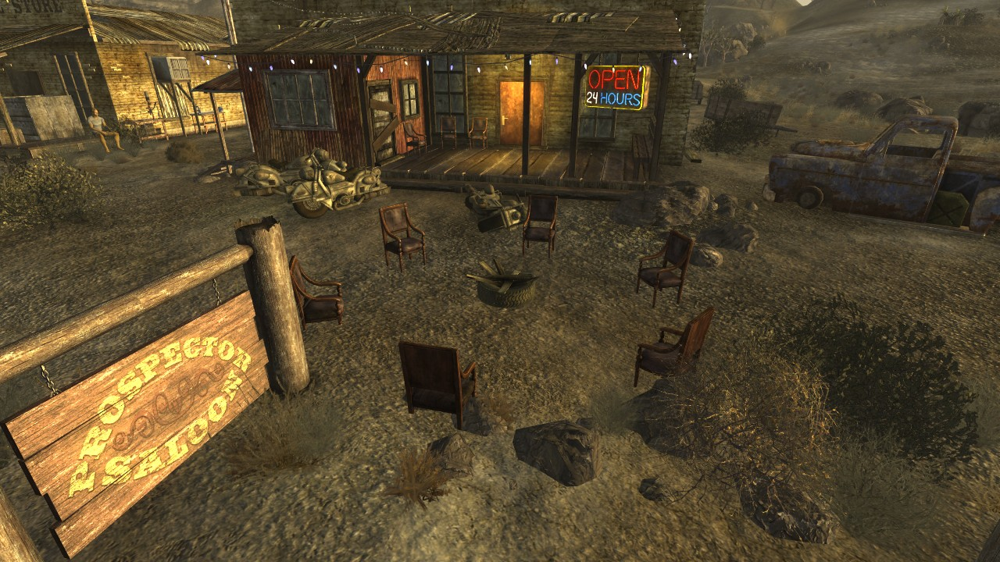
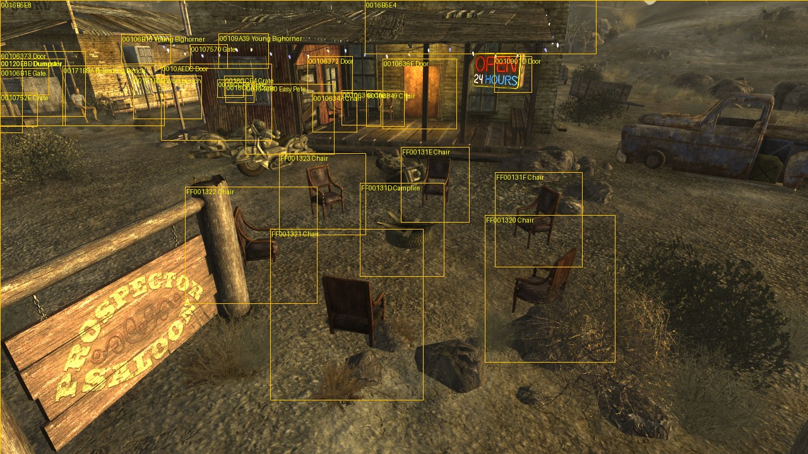
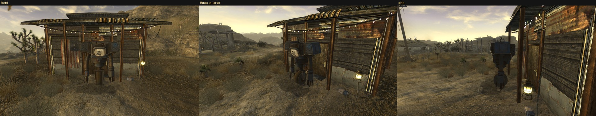

# fnv-mcp

**MCP tools that let an AI agent build, run, debug and change Fallout: New Vegas: the running game, the engine
itself and the plugins that mod it.**



*An agent built this camp in the running game. Seven `fnv_place` calls put the campfire and the six chairs on the
ground in front of the Prospector Saloon, `fnv_camera` set the view and `fnv_photo` took the picture.*

> **Beta (0.5.0b1).** It is tested on one PC: Windows 11 and the Steam game, with Mod Organizer 2 and without, and
> Claude Code as the client. It has not been set up on a second machine yet, so expect rough edges in setup. The
> open problems are listed in [KNOWN-ISSUES.md](bridge/docs/KNOWN-ISSUES.md).

fnv-mcp is a standalone continuation of [geck-mcp-nv](https://github.com/2Shay96/geck-mcp-nv) by **2Shay**, which
it is built on and keeps the full history of; see "Built on geck-mcp-nv" below.

## What it is

One MCP server with <!-- counts -->**139 `fnv_*` tools**<!-- /counts --> for the game, its engine and plugins built
from a JSON spec. The count is checked against the server's own tool list by the tests.

- **Engine knowledge**: function and class lookup from the decompilation, a symbol database with source lines and
  named locals for the retail exe, crash explanation, engine warnings.
- **Live control**: time control (pause, step, frame advance), breakpoints and a debugger, screenshots and photo
  sheets ("eyes"), walking, talking, using doors and fast travel ("hands"), forms and scripts changed in place.
- **Engine changes**: C modules hooked into the running game, decomp functions recompiled with the game's own
  compiler and swapped in, both exportable as normal xNVSE plugins.
- **Performance and checks**: a sampling profiler, code coverage, thread, memory and object views, animation, audio,
  physics and formula inspectors, whole-plugin crawls, load-order bisection and a self-test.

## What it looks like

Every picture on this page was taken by an agent through the tools, in the running game.

### Build a place

The camp at the top of the page is seven calls: one for the campfire, one for each chair, each chair turned to
face the fire. `snap=true` rests an object on the ground under its whole footprint.

```text
fnv_place  at  base=CampfireCrafting01  position=[x, y, z]  snap=true
fnv_place  at  base=0008B5DE  position=[x, y, z]  rotation=[0, 0, heading]  snap=true      (six times)
fnv_camera orbit  ref=<the campfire>  yaw=345  pitch=24  distance=470
fnv_photo  view  hide_hud=true
```

Every placement is written to a journal, so `fnv_undo` takes it out again and `fnv_author` can export it to a
plugin. The `fnv_guide` topic `build-a-place` has the steps.

### See what is in view



*`fnv_photo view label=true`: the same view with a box, a form id and a name on every reference. The agent reads
the picture and can then act on "that chair" by its id. The ids that start with `FF` are the objects it placed.
(References behind a wall get a box too; that is a known limit.)*

### Look at one thing from every side



*`fnv_photo ref ref=GSVictorRef angles=[front, three_quarter, side]`: one call moves the camera around a
reference and returns one sheet. Here it is Victor, outside his shack in Goodsprings.*

## What it needs

| What | Tested version | Needed? |
| --- | --- | --- |
| Windows 10 or 11 | Windows 11 | required (Windows only) |
| Fallout: New Vegas, Steam edition | FalloutNV.exe 1.4.0.525 | required |
| Python | 3.12 | required |
| An MCP client (Claude Code, Claude Desktop, Codex...) | Claude Code | required |
| [xNVSE](https://github.com/xNVSE/NVSE) | 6.4.9 | required |
| [JIP LN NVSE](https://www.nexusmods.com/newvegas/mods/58277) | 57.30 | required |
| [Yvile's Crash Logger](https://www.nexusmods.com/newvegas/mods/82540) | 5.17a | required |
| [Zig](https://ziglang.org/download/) | 0.14.1 | required for the live tools: it builds the engine companion that runs inside the game |
| A checkout of [fnv_decomp](https://github.com/momusdigital/fnv_decomp) | current `main` | required for engine knowledge: you generate the engine map from it on your own machine |
| [Mod Organizer 2](https://github.com/ModOrganizer2/modorganizer), portable | 2.5.2 | optional: a dev profile of its own. Without it the tools use the game as Steam installed it |
| [FNV 4GB Patcher](https://www.nexusmods.com/newvegas/mods/62552) | | recommended |
| capstone, your own unpacked FalloutNV.exe (made with [Steamless](https://github.com/atom0s/Steamless) from your own copy), the compiler kit for `fnv_code`, an fnvsym proof folder for the `fnv_name_*` tools | | optional |

The full list of downloads, with where each comes from and which tools need it, is
"What you need (the downloads)" in [the setup guide](bridge/docs/FNV-MCP-SETUP.md#what-you-need-the-downloads);
`fnv_setup_check` reports the same list on your machine. Nothing from the game or the decompilation is in this
repository: each user builds the engine map and symbol database from their own copies.

## Start

Follow [bridge/docs/FNV-MCP-SETUP.md](bridge/docs/FNV-MCP-SETUP.md), the one setup guide. It starts from
`bridge/projects/example-fnv.json` and ends with the agent reading the running game. fnv-mcp is not a pip package:
run it from a clone with `python run_mcp.py --project <file>` (the guide registers exactly that with your MCP
client). Then a first prompt:

> Call fnv_setup_check and fix what it reports with me, then launch the game with fnv_game launch and show me
> fnv_status.

Every tool, with its actions, parameters and an example call, is in [TOOLS.md](bridge/docs/TOOLS.md); the
documentation index is [bridge/docs/README.md](bridge/docs/README.md), and the `fnv_guide` tool has step-by-step
guides. To give your own agent the rules for working with the tools, copy
[AGENT-GUIDE.md](bridge/docs/AGENT-GUIDE.md) into your mod project. Open problems are
listed in [KNOWN-ISSUES.md](bridge/docs/KNOWN-ISSUES.md). To remove it again, see "Uninstall" in the setup guide.

## Safety

- The agent can only look until you say otherwise. `fnv.engine_control` is `"read"` by default; `"full"` lets the
  agent change the game and run code in it. **`"full"` means code execution as your Windows user**, so turn it on
  only for an agent you trust.
- Changes to the running game are journaled and `fnv_undo` reverses them. Files put into the mod profile are not
  undone that way.
- With Mod Organizer 2 the tools act on a dev profile of its own, not the one you play with. Without it they act on
  your real game, and changing its files needs a second switch (`fnv.allow_direct_install_changes`).

"Safety levels" in [the setup guide](bridge/docs/FNV-MCP-SETUP.md#safety-levels) has the details.

## Credits

- **2Shay**: author of [geck-mcp-nv](https://github.com/2Shay96/geck-mcp-nv), the project this repository is built
  on: the server's start and the offline plugin builder (`fnv_spec`).
- **maksimka2432fr23**: author of GECK MCP for Fallout 3, the start of geck-mcp-nv's first server.
- **HUNK2**: the `fnv_*` live, engine and debugging tools and the engine companion.
- The [fnv_decomp](https://github.com/momusdigital/fnv_decomp) project, xNVSE, JIP LN NVSE, kNVSE and Yvile's
  Crash Logger, whose work these tools read or follow; Mod Organizer 2, Zig, Steamless, Capstone and the MCP Python
  SDK, which they use; see [THIRD_PARTY_NOTICES.md](THIRD_PARTY_NOTICES.md).

## Built on geck-mcp-nv

fnv-mcp started as 2Shay's [geck-mcp-nv](https://github.com/2Shay96/geck-mcp-nv) (version 0.4.0 Beta): a GECK
bridge, an offline plugin builder from a JSON spec, script compilation with GECK's own compiler, runtime
diagnostics and an opt-in console companion. The plugin builder lives on as `fnv_spec`
([bridge/README.md](bridge/README.md)); the GECK editor tools, their 32-bit helper and the runtime and console
tools were removed on 2026-11-18, since the `fnv_*` tools do those jobs in the running game. geck-mcp-nv's own
release history is in [CHANGELOG.md](CHANGELOG.md), and the removed code is in the git history.

## Licence

- MIT. See [LICENSE](LICENSE) and [THIRD_PARTY_NOTICES.md](THIRD_PARTY_NOTICES.md).
- The plugin builder and the server's base, from geck-mcp-nv, © 2026 2Shay. The `fnv_*` tools and the engine
  companion © 2026 HUNK2.
- Not affiliated with or endorsed by Bethesda Softworks, ZeniMax, Microsoft, Anthropic or OpenAI.
  Fallout and G.E.C.K. are trademarks of their owners.
